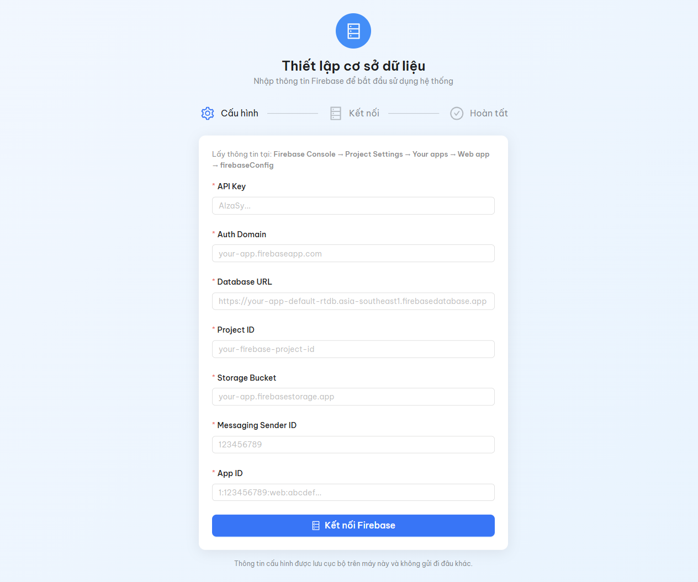
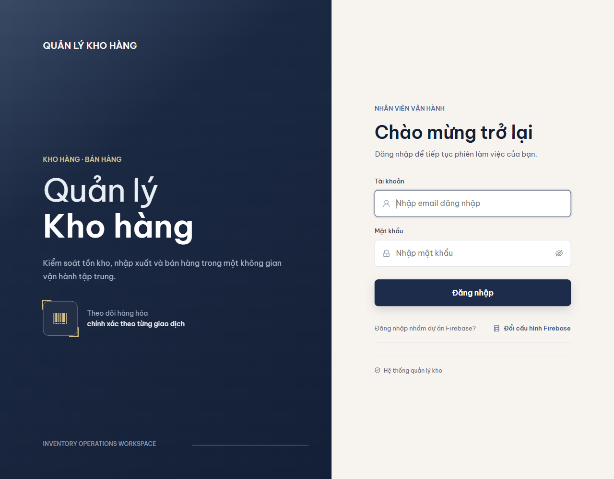

# Quản lý kho hàng

Ứng dụng quản lý kho và bán hàng POS dành cho máy tính Windows, có giao diện tiếng Việt. Hệ thống tập trung danh mục sản phẩm, tồn kho, phiếu nhập, phiếu xuất, hóa đơn bán hàng và báo cáo trong cùng một ứng dụng.

Dữ liệu nghiệp vụ được lưu trên **Firebase của đơn vị sử dụng**. Mỗi máy kết nối bằng cấu hình riêng và tài khoản được cấp; bộ cài không kèm tài khoản, cơ sở dữ liệu doanh nghiệp hoặc dịch vụ Firebase dùng chung.

**Phiên bản:** 1.0.0 · **Bản đóng gói:** Windows x64 · **Công nghệ:** Electron, React, TypeScript, Firebase.

## Mục lục

- [Tổng quan chức năng](#tổng-quan-chức-năng)
- [Ảnh giao diện](#ảnh-giao-diện)
- [Yêu cầu sử dụng](#yêu-cầu-sử-dụng)
- [Tải và cài đặt](#tải-và-cài-đặt)
- [Thiết lập lần đầu](#thiết-lập-lần-đầu)
- [Vai trò và quyền sử dụng](#vai-trò-và-quyền-sử-dụng)
- [Hướng dẫn sử dụng](#hướng-dẫn-sử-dụng)
- [In phiếu và xuất dữ liệu](#in-phiếu-và-xuất-dữ-liệu)
- [Sao lưu và khôi phục](#sao-lưu-và-khôi-phục)
- [Dữ liệu, chuyển máy và nâng cấp](#dữ-liệu-chuyển-máy-và-nâng-cấp)
- [Cài đặt môi trường phát triển](#cài-đặt-môi-trường-phát-triển)
- [Build và đóng gói](#build-và-đóng-gói)
- [Cấu trúc mã nguồn](#cấu-trúc-mã-nguồn)
- [Kiểm thử và giới hạn](#kiểm-thử-và-giới-hạn)
- [Xử lý sự cố](#xử-lý-sự-cố)
- [Tài liệu liên quan](#tài-liệu-liên-quan)
- [Giấy phép](#giấy-phép)

## Tổng quan chức năng

| Phân hệ | Chức năng chính |
| --- | --- |
| Dashboard | Theo dõi số sản phẩm, cảnh báo tồn kho, hoạt động kho; hiển thị doanh thu cho quản trị viên |
| Sản phẩm | Tìm kiếm, lọc, tạo và sửa mã hàng; quản lý danh mục, nhà cung cấp, giá và tồn tối thiểu; lưu trữ sản phẩm đủ điều kiện |
| Nhập kho | Lập phiếu nhập theo nhà cung cấp, sản phẩm, số lượng và giá nhập; kiểm tra trước khi xác nhận; cập nhật tồn |
| Xuất kho | Lập phiếu xuất, kiểm tra tồn khả dụng; xác nhận chứng từ và trừ tồn |
| Bán hàng POS | Giỏ nhiều sản phẩm, giảm giá dòng hàng/hóa đơn, áp dụng voucher có sẵn; tạo bill và cập nhật tồn |
| Lịch sử | Tra cứu nhập, xuất, bán; tìm kiếm và lọc theo loại, ngày, trạng thái; xuất Excel |
| Báo cáo | Tổng thu, tổng chi nhập hàng, lợi nhuận gộp theo giá vốn đã lưu; biểu đồ và Excel theo khoảng ngày |
| Cài đặt | Thông tin doanh nghiệp, giao diện sáng/tối, đổi cấu hình Firebase; quản lý trạng thái tài khoản dành cho admin |
| Sao lưu & khôi phục | Snapshot JSON có SHA-256, xem trước ảnh hưởng, gộp/thay thế nhóm dữ liệu và báo cáo toàn vẹn; cần backend Functions |

Các thao tác thay đổi tồn kho đi qua chứng từ. Phiếu bị hủy được ghi nhận trạng thái và lý do, đồng thời hoàn tác tồn theo kiểm tra nghiệp vụ.

## Ảnh giao diện

### Thiết lập cơ sở dữ liệu



### Đăng nhập



Đây là ảnh thật từ bản ứng dụng đã đóng gói, chụp bằng hồ sơ kiểm thử riêng. Không có tài khoản hoặc dữ liệu doanh nghiệp trong ảnh. Sau khi chủ project tự cấu hình và đăng nhập, các màn hình Dashboard, Sản phẩm, Nhập kho, Xuất kho, Bán hàng, Lịch sử, Báo cáo và Cài đặt đã được mở trực tiếp để đối chiếu hướng dẫn bên dưới. Ảnh các trang đang chứa email, đối tác và chứng từ thật không được đưa vào gói công khai.

## Yêu cầu sử dụng

| Thành phần | Yêu cầu |
| --- | --- |
| Hệ điều hành | Bản đóng gói dành cho Windows 10/11 x64; đã thử trên Windows 11 Home Single Language, build 10.0.26300, 64-bit |
| Kết nối | Internet tới Firebase để đăng nhập, tải dữ liệu và ghi giao dịch |
| Backend | Firebase Authentication bật Email/Password; Realtime Database có dữ liệu và Rules phù hợp |
| Tài khoản | Tài khoản Firebase Auth có hồ sơ ứng dụng đang hoạt động tại `users/{uid}` |
| Sao lưu/khôi phục | Các Cloud Functions tương ứng ở vùng `us-central1`, với gói Firebase hỗ trợ triển khai Functions |
| In và đọc file xuất | In giấy cần máy in/driver; mở XLSX cần phần mềm đọc bảng tính phù hợp |
| Dung lượng | Nên dành ít nhất 1 GB trống cho app, file tạm và cache; đây là mức dự phòng, không phải benchmark |

Người dùng **bộ cài** không cần cài Node.js, npm, Java, Python, Microsoft Excel hoặc WebView2 để chạy ứng dụng và tạo file xuất. Electron cùng Chromium/Node đã nằm trong gói. Không có model AI hoặc chương trình xử lý bên ngoài cần tải thêm.

Ứng dụng cần backend và kết nối mạng; không được giới thiệu là phần mềm kho offline độc lập. Chưa xác nhận tương thích Windows 32-bit, Windows ARM, macOS hoặc Linux.

## Tải và cài đặt

**Trạng thái hiện tại:** bản phát hành đã được chuẩn bị cục bộ, chưa có URL GitHub repository/Release được xác định. Các bước tải dưới đây áp dụng khi bản `v1.0.0` đã được đăng lên repository chính thức.

1. Mở mục **Releases** của repository và chọn bản `v1.0.0`.
2. Trong **Assets**, tải:
   - `QuanLyKhoHang-1.0.0-windows-x64-setup.exe` — bộ cài kèm runtime.
   - `SHA256SUMS.txt` — checksum đối chiếu file tải về.
3. Kiểm tra SHA256 trong PowerShell tại thư mục tải:

   ```powershell
   Get-FileHash -Algorithm SHA256 -LiteralPath ".\QuanLyKhoHang-1.0.0-windows-x64-setup.exe"
   ```

4. Đối chiếu đủ 64 ký tự hex với dòng cùng tên trong `SHA256SUMS.txt`, không phân biệt hoa/thường. Nếu khác, tải lại trước khi chạy.
5. Đóng ứng dụng đang mở, chạy bộ cài, chọn thư mục riêng rồi bấm **Install** → **Finish**.
6. Mở shortcut **QuanLyKhoHang** trên Desktop hoặc Start Menu.

Bộ cài dành cho tài khoản Windows hiện tại, cho phép chọn thư mục và có mục gỡ cài đặt. Không chọn thư mục đang chứa tài liệu cá nhân hoặc backup làm thư mục cài.

File `inventory-system-1.0.0-source.zip` và mục **Source code** trên GitHub dành cho người phát triển; chúng không phải bộ cài. Xem thêm [hướng dẫn cài đặt](docs/INSTALLATION.md).

## Thiết lập lần đầu

### 1. Chuẩn bị Firebase

Nếu đơn vị đã có hệ thống đang vận hành, nhờ quản trị viên cung cấp cấu hình và tài khoản hiện hành. Không tạo database mới hoặc thay Rules của kho đang dùng chỉ để cài thêm máy.

Nếu triển khai lần đầu, quản trị viên cần tạo Firebase project, đăng ký Web app, bật Email/Password, chuẩn bị Realtime Database và tạo tài khoản/hồ sơ admin đầu tiên. Hướng dẫn nằm trong [FIREBASE_DEPLOYMENT.md](FIREBASE_DEPLOYMENT.md).

### 2. Nhập cấu hình trên máy

Mở app, tại **Thiết lập cơ sở dữ liệu**, nhập các giá trị từ Firebase Console → **Project settings → General → Your apps → Web app**:

| Ô trong ứng dụng | Giá trị từ Firebase |
| --- | --- |
| API Key | `apiKey` |
| Auth Domain | `authDomain` |
| Database URL | `databaseURL`, lấy URL Realtime Database nếu cấu hình Web app chưa hiển thị |
| Project ID | `projectId` |
| Storage Bucket | `storageBucket` |
| Messaging Sender ID | `messagingSenderId` |
| App ID | `appId` |

Bấm **Kết nối Firebase**, sau đó đăng nhập. Thông báo thiết lập thành công xác nhận SDK đã được khởi tạo; quyền truy cập dữ liệu và sự hiện diện của Functions còn phụ thuộc cấu hình backend.

### 3. Đăng nhập

Nhập email và mật khẩu được quản trị viên cấp. Hồ sơ `users/{uid}` cần có `email` trùng với tài khoản Auth, `role` là `admin` hoặc `staff`, và `status` là `active`.

Khi mở lại một phiên đã lưu, app có thể yêu cầu **Xác thực mật khẩu để tiếp tục**. Nếu cần dùng tài khoản khác, chọn đăng xuất rồi đăng nhập lại. Ứng dụng không kèm tài khoản/mật khẩu mặc định.

## Vai trò và quyền sử dụng

| Thao tác trong phiên bản hiện tại | Admin | Staff |
| --- | --- | --- |
| Xem Dashboard, tồn kho, danh sách sản phẩm và lịch sử | Có | Có |
| Xem số liệu tài chính trên Dashboard, trang Báo cáo | Có | Không |
| Tạo/sửa/lưu trữ sản phẩm; quản lý danh mục, nhà cung cấp | Có | Không |
| Lập phiếu nhập hoặc xuất kho | Có | Không |
| Lập hóa đơn bán hàng POS | Có | Có |
| Hủy chứng từ và hoàn tác tồn | Có | Không |
| In phiếu, xuất dữ liệu nghiệp vụ trên màn hình được truy cập | Có | Có |
| Lưu thông tin doanh nghiệp; quản lý trạng thái tài khoản | Có | Không |
| Sao lưu và khôi phục | Có, cần backend phù hợp | Không |
| Đổi cấu hình Firebase của máy, chỉnh giao diện | Có | Có |

Đây là mô tả quyền ở tầng ứng dụng theo mã nguồn hiện tại. Phiên đã được đối chiếu trực tiếp là Admin; chưa đăng nhập riêng một tài khoản Staff để kiểm thử toàn bộ bảng quyền. Quyền phía máy chủ còn do Firebase Rules/Functions quyết định. Việc thấy một mục menu không có nghĩa tài khoản được phép thực hiện mọi thao tác trong mục đó.

## Hướng dẫn sử dụng

### Luồng vận hành đề xuất

**Thiết lập Firebase → Đăng nhập → Cài đặt thông tin doanh nghiệp → Tạo danh mục và sản phẩm → Nhập hàng → Xuất kho hoặc bán hàng → Tra cứu, báo cáo và sao lưu.**

### Nhận diện các màn hình

Tên mục trên sidebar và tiêu đề nội dung có thể khác nhau. Bảng dưới được đối chiếu trong phiên Admin đang chạy:

| Mục menu | Tiêu đề/khối nhận diện | Thao tác chính |
| --- | --- | --- |
| Dashboard | Tổng quan kho hàng | Xem chỉ số, nhịp vận hành, sức khỏe tồn kho, ưu tiên bổ sung và giao dịch gần đây |
| Sản phẩm | Danh mục sản phẩm | Thêm mã hàng mới, Xuất Excel, Tìm kiếm, Làm mới |
| Nhập kho | Quản lý Nhập kho | Lập phiếu nhập hàng và xem danh sách phiếu nhập kho |
| Xuất kho | Quản lý Xuất kho | Lập phiếu xuất hàng và xem danh sách hóa đơn xuất kho |
| Bán hàng | Quầy Bán Hàng & Tính Tiền (POS) | Thêm sản phẩm vào giỏ, giảm giá, xác nhận và xem trước bill |
| Lịch sử | Lịch Sử Biến Động Kho | Tìm theo hóa đơn/sản phẩm/đối tác, lọc giao dịch và xuất Excel |
| Báo cáo | Báo cáo tài chính cửa hàng | Chọn khoảng thời gian, Làm mới, Xuất Excel |
| Cài đặt | Cài đặt hệ thống | Doanh nghiệp, tài khoản, giao diện, Firebase, sao lưu/khôi phục |

Ở cửa sổ nhỏ, bảng có nhiều cột sẽ có thanh cuộn ngang phía dưới; cuộn sang phải để xem cột cuối và các nút thao tác. Trang dài dùng thanh cuộn nội dung ở mép phải. Thu gọn sidebar hoặc chỉnh zoom nếu cần thêm không gian; không nhầm nút in/xem trước với nút hủy chứng từ bên cạnh.

### Dashboard

Dashboard có bốn khối chỉ số trong phiên Admin: **Tổng sản phẩm**, **Sắp hết hàng**, **Hết hàng**, **Doanh thu hôm nay**. Bấm **Chi tiết** để đi tới nội dung liên quan; dùng **Xem lịch sử** hoặc **Bán hàng** để chuyển nhanh.

Các khối phía dưới gồm **Nhịp vận hành 7 ngày**, **Sức khỏe tồn kho**, **Ưu tiên bổ sung** và **Giao dịch gần đây**. Biểu đồ có nút lùi/tiến khoảng ngày; vùng biểu đồ hỗ trợ kéo ngang, Shift + con lăn hoặc phím mũi tên theo hướng dẫn trên giao diện. Danh sách ưu tiên bổ sung có lối tắt tới nhập kho; giao dịch gần đây có **Xem tất cả** để mở lịch sử.

Số lượng và doanh thu hiển thị phụ thuộc dữ liệu/thời điểm của kho đang kết nối; không dùng các con số trong một ảnh chụp làm dữ liệu mẫu mặc định.

### Sản phẩm

1. Vào **Sản phẩm**, tìm theo mã/tên hàng hoặc lọc theo danh mục, tình trạng tồn.
2. Admin bấm **Thêm mã hàng mới** để tạo mã hàng với tên, đơn vị tính, danh mục, giá nhập, giá bán, tồn tối thiểu; bổ sung nhà cung cấp và ghi chú nếu cần.
3. Chỉnh sửa thông tin bằng thao tác sửa trong danh sách. Mã hàng phải duy nhất.
4. Tồn kho trong form sản phẩm không sửa trực tiếp. Dùng chứng từ nhập/xuất/bán để ghi nhận thay đổi; sản phẩm mới có tồn ban đầu bằng 0.
5. Chỉ lưu trữ sản phẩm khi tồn bằng 0. Thao tác này loại sản phẩm khỏi danh sách hoạt động, không phải hướng dẫn xóa chứng từ lịch sử.

Trạng thái tồn được tính từ số lượng và tồn tối thiểu: hết hàng khi số lượng không dương; các mức cảnh báo được xác định theo ngưỡng tồn đã đặt. Nên cấu hình ngưỡng phù hợp với từng mã hàng.

### Nhập kho

Ở **Nhập kho**, bên trái là **Lập phiếu nhập hàng**, bên phải là **Danh sách phiếu nhập kho**.

1. Chọn **Ngày nhập**, nhập **Mã Hóa đơn** hoặc để trống để tự sinh.
2. Chọn **Nhà cung cấp** trước. Ô **Mặt hàng sản phẩm** bị vô hiệu hóa khi chưa chọn nhà cung cấp; danh sách hàng phụ thuộc lựa chọn này.
3. Chọn sản phẩm, nhập **Tổng số lượng** và **Giá nhập (đ)**; kiểm tra **Thành tiền (đ)** được tính.
4. Bấm **Xác nhận lập phiếu nhập**, đọc lại nội dung xác nhận rồi mới ghi phiếu. Khi thành công, tồn tăng theo số lượng nhập.

Danh sách phiếu hỗ trợ tra cứu, mở phiếu in và hủy theo quyền. Khi hủy phiếu nhập, hệ thống kiểm tra tồn còn đủ để hoàn tác lượng đã nhập; nhập lý do hủy theo yêu cầu.

### Xuất kho

Ở **Xuất kho**, bên trái là **Lập phiếu xuất hàng**, bên phải là **Danh sách hóa đơn xuất kho**.

1. Chọn **Ngày xuất**, nhập **Mã Hóa đơn** hoặc để trống để tự sinh.
2. Điền **Khách hàng / Đơn vị nhận** và chọn **Mặt hàng cần xuất**.
3. Kiểm tra **Tồn kho thực tế**, nhập **Đơn giá xuất (đ)** và **Tổng số lượng xuất**.
4. Kiểm tra **Thành tiền (đ)**, bấm **Xác nhận lập phiếu xuất** và xác nhận nội dung. Số lượng xuất không được vượt tồn khả dụng.

Khi ghi thành công, tồn giảm; hủy phiếu xuất hợp lệ sẽ hoàn trả lượng tồn tương ứng.

### Bán hàng POS

1. Mở **Bán hàng**, chọn thời gian, số hóa đơn nếu cần và tên khách; tên khách để trống dùng khách bán lẻ vãng lai.
2. Tìm sản phẩm, xem tồn hiện tại, nhập số lượng và thêm vào giỏ.
3. Kiểm tra các dòng giỏ, đơn giá, giảm giá dòng hàng và giảm giá toàn hóa đơn.
4. Nếu có voucher đã được cấu hình, nhập mã và bấm áp dụng; mã cần đáp ứng điều kiện hiệu lực/giá trị đơn hàng.
5. Kiểm tra **Tạm tính**, các khoản giảm giá và **Khách cần trả**, rồi bấm **Xác nhận & Xuất hóa đơn**. Một hóa đơn ghi nhận toàn bộ giỏ và trừ tồn các mặt hàng tương ứng.
6. Từ danh sách bill, mở xem trước phiếu để in/lưu PDF. Admin có thể hủy bill kèm lý do; thao tác hủy hợp lệ hoàn trả tồn.

README không giả định có màn hình tự tạo voucher, thanh toán trực tuyến hoặc tích hợp kế toán ngoài mã nguồn hiện có.

Khi giỏ trống, **Thêm vào giỏ**, **Áp dụng** hoặc **Xác nhận & Xuất hóa đơn** có thể đang bị vô hiệu hóa do chưa đủ điều kiện. Hãy chọn sản phẩm và nhập dữ liệu hợp lệ trước; đây không phải dấu hiệu bộ cài thiếu thư viện. Không bấm xác nhận hóa đơn chỉ để thử giao diện trên kho thật.

### Lịch sử

Mở **Lịch sử** để tra cứu nhập, xuất và bán hàng. Ô tìm kiếm có nhãn **Tìm theo hóa đơn, sản phẩm, đối tác...**; ba bộ lọc bên cạnh lần lượt là loại giao dịch, ngày và trạng thái. Kiểm tra trạng thái **Đã ghi nhận**, **Đã hủy** hoặc **Chờ xử lý** khi đối chiếu chứng từ; xuất Excel từ kết quả đang lọc. Các dòng bill có nút mở rộng để xem thông tin chi tiết.

### Báo cáo

Trang **Báo cáo** dành cho admin, mặc định mở **Tháng này**. Có khoảng thời gian nhanh **Hôm nay**, **Tháng này**, **Quý này** hoặc chọn khoảng ngày. Báo cáo loại chứng từ đã hủy khỏi phần tính tổng.

Nếu thấy **Không có chứng từ trong kỳ**, kiểm tra hai mốc ngày trước: dữ liệu ở Lịch sử có thể thuộc tháng khác nên không xuất hiện trong kỳ hiện tại. Chọn đúng khoảng ngày hoặc bấm **Làm mới**; không cần tạo thêm chứng từ để làm báo cáo có dữ liệu. Nút **Xuất Excel** chỉ tạo được báo cáo khi dữ liệu đã tải và kỳ có chứng từ.

| Chỉ số | Ý nghĩa theo cách tính hiện tại |
| --- | --- |
| Tổng thu | Tổng giá trị phiếu xuất và hóa đơn bán hàng hợp lệ trong kỳ |
| Tổng chi | Tổng giá trị phiếu nhập hợp lệ trong kỳ |
| Lợi nhuận gộp | Cộng lợi nhuận của các chứng từ đầu ra có snapshot giá vốn; không suy diễn đủ giá vốn cho chứng từ thiếu dữ liệu |
| Tổng chứng từ | Số chứng từ nhập, xuất và bán hợp lệ trong khoảng thời gian |

Tổng thu và tổng chi là chỉ số tổng hợp từ chứng từ trong app, không khẳng định đã đối soát tiền mặt/ngân hàng. Lợi nhuận gộp không đồng nghĩa lợi nhuận ròng sau thuế và chi phí vận hành. Theo dõi cảnh báo thiếu snapshot giá vốn khi đọc số liệu.

### Cài đặt, tài khoản và giao diện

- Admin lưu **Tên doanh nghiệp**, **Địa chỉ**, **Số điện thoại** tại **Cài đặt hệ thống**.
- Bật/tắt **Chế độ Ban đêm (Dark Mode)** để đổi giao diện.
- Dùng nút thu gọn sidebar và thanh thu phóng trên header; mức zoom hỗ trợ 70–150%, bấm giá trị phần trăm để về 100%.
- Admin khóa/mở khóa hoặc lưu trữ/khôi phục hồ sơ tài khoản. UI chặn thao tác lên chính mình và các tài khoản admin khác theo chính sách hiện tại.
- Tạo tài khoản Auth, cấp vai trò ban đầu hoặc quản trị danh tính cần thực hiện bằng công cụ quản trị phù hợp; không coi lưu trữ hồ sơ trong app là xóa tài khoản Firebase Authentication.
- Menu tài khoản trên header có thông tin vai trò và **Đăng xuất**.
- **Đổi cấu hình Firebase** ngắt kết nối project hiện tại trên máy và yêu cầu cấu hình/đăng nhập lại; không chuyển dữ liệu giữa hai project.

## In phiếu và xuất dữ liệu

Các phiếu nhập, xuất và bán mở cửa sổ xem trước riêng trong Electron. Dùng **In phiếu** để mở hộp thoại máy in, **Lưu PDF** để chọn nơi lưu hoặc **Đóng** để quay về công việc. Hủy in/lưu không đồng nghĩa hủy chứng từ.

| Nguồn xuất | File hoặc cấu trúc |
| --- | --- |
| Danh sách sản phẩm | `DanhMuc_HangHoa_YYYYMMDD.xlsx`, sheet `Danh_muc_san_pham` |
| Lịch sử nhập | `lich-su-nhap-kho.xlsx` |
| Lịch sử xuất | `lich-su-xuat-kho.xlsx` |
| Lịch sử bán hàng | `lich-su-ban-hang.xlsx`, gồm `Hóa đơn` và `Chi tiết sản phẩm` |
| Lịch sử tổng hợp | `lich-su-bien-dong-kho.xlsx` |
| Báo cáo tài chính | `Bao_cao_tai_chinh_Tu_DD-MM-YYYY_Den_DD-MM-YYYY.xlsx`, gồm 4 sheet: `Tổng quan`, `Theo ngày`, `Chi tiết chứng từ`, `Chi tiết mặt hàng` |
| Sao lưu | JSON có thông tin phiên bản, phạm vi dữ liệu và checksum SHA-256 |

Chọn thư mục tài liệu ngoài thư mục cài cho file xuất. Excel/PDF phục vụ đọc và đối chiếu; chúng không thay thế bản sao lưu JSON và không phải file để nhập lại toàn bộ kho.

## Sao lưu và khôi phục

Tính năng nằm trong **Cài đặt → Sao lưu & Khôi phục dữ liệu**, chỉ dành cho admin và cần các Cloud Functions tương ứng đã triển khai.

Khối này nằm phía dưới các thẻ cài đặt giao diện, thông tin phần mềm và cấu hình cơ sở dữ liệu; cuộn xuống nếu chưa thấy. Việc mở được khối sao lưu không xác nhận Functions đã hoạt động: cần kiểm tra riêng thao tác tạo/khôi phục trên môi trường được phép.

### Tạo bản sao

Bấm **Tạo & tải bản sao lưu**, chọn nơi lưu JSON và xác nhận file đã được ghi. Snapshot chứa dữ liệu nghiệp vụ và có thể gồm hồ sơ người dùng; không gồm mật khẩu, token hoặc tài khoản Firebase Authentication. Danh sách file gần đây trên thiết bị chỉ lưu thông tin file, không giữ lại toàn bộ nội dung backup để tải lại.

### Khôi phục có kiểm soát

1. Chọn/kéo file JSON do ứng dụng tạo, tối đa 20 MB. Hệ thống kiểm tra định dạng và checksum.
2. Chọn nhóm dữ liệu; hồ sơ người dùng và audit log không bật mặc định.
3. Chọn **Gộp** hoặc **Thay thế**. Gộp thêm bản ghi mới và dùng bản sao lưu khi trùng ID; Thay thế có thể xóa bản ghi hiện tại không có trong file tại nhóm đã chọn.
4. Bấm **Phân tích ảnh hưởng**, đọc số bản ghi thêm/cập nhật/xóa và cảnh báo trước khi tiếp tục.
5. Nhập đúng `KHOI PHUC` hoặc `RESTORE`, xác nhận thêm nếu dùng Thay thế.
6. Bấm **Tạo bản an toàn & khôi phục**. Quy trình yêu cầu lưu `pre-restore-backup` trước khi ghi; nếu không lưu được thì dừng.
7. Đọc báo cáo toàn vẹn sau khôi phục và đối chiếu dữ liệu.

Checksum kiểm tra tính toàn vẹn nội dung, không mã hóa file và không chứng minh người tạo file đáng tin cậy. Giữ backup ở nơi có quyền truy cập phù hợp; không đăng backup/hồ sơ người dùng lên GitHub. Thử khôi phục trên môi trường riêng trước khi thao tác kho đang vận hành.

## Dữ liệu, chuyển máy và nâng cấp

| Loại dữ liệu | Nơi lưu và cách xử lý |
| --- | --- |
| Sản phẩm, chứng từ, cấu hình doanh nghiệp | Firebase của đơn vị; nhiều máy dùng cùng backend khi được cấu hình và cấp quyền phù hợp |
| Cấu hình Firebase, phiên đăng nhập, theme/zoom, lịch sử tên file backup | Hồ sơ cục bộ do Electron quản lý |
| PDF, XLSX, JSON đã xuất | Vị trí người dùng chọn hoặc nơi lưu tải xuống của hệ thống |

Hồ sơ mặc định thường ở `%APPDATA%\inventory-system`; có thể khác khi môi trường tùy chỉnh. Không chia sẻ nguyên hồ sơ Chromium đang dùng vì có thể chứa phiên xác thực. Biến `INVENTORY_USER_DATA_DIR` dành cho chạy với hồ sơ riêng bằng đường dẫn tuyệt đối; không cần đặt khi sử dụng thông thường.

**Chuyển máy:** cài app trên máy mới → nhập cấu hình Firebase của đơn vị → đăng nhập tài khoản được cấp. Không cần sao chép thư mục cài hoặc khôi phục toàn bộ database chỉ để thêm máy truy cập. Đổi sang Firebase project khác là một việc chuyển dữ liệu/backend riêng.

**Cài lại/nâng cấp:** đóng app, sao lưu theo quy trình đơn vị rồi chạy bộ cài mới. Giữ thư mục cài khi nâng cấp. Installer được cấu hình giữ hồ sơ cục bộ; phiên bản hiện tại chưa có tự cập nhật.

**Gỡ cài đặt:** Windows Settings → Apps → Installed apps → **QuanLyKhoHang → Uninstall**. Gỡ app không xóa database Firebase và được cấu hình giữ hồ sơ cục bộ. Các file đã xuất ngoài thư mục cài vẫn do người dùng quản lý.

## Cài đặt môi trường phát triển

### Công nghệ và phiên bản đã dùng

| Thành phần | Phiên bản trong môi trường đã kiểm tra |
| --- | --- |
| Node.js / npm | 22.23.2 / 10.9.8 |
| Electron / electron-builder | 41.7.1 / 26.15.3 |
| React / React DOM | 19.2.7 / 19.2.7 |
| TypeScript / Vite | 6.0.3 / 8.0.16 |
| Ant Design / Recharts | 6.4.4 / 3.8.1 |
| Firebase JS SDK | 12.15.0 |
| ExcelJS / SheetJS | 4.4.0 / 0.18.5 |

Đây là phiên bản từ lockfile/môi trường đã kiểm tra, không phải tuyên bố phiên bản mới nhất. `package.json` yêu cầu Node.js từ 22.12.0 đến dưới 23. Dùng `npm ci` để cài theo lockfile.

### Chạy frontend và Electron

Giải nén nguồn hoặc clone repository đã công bố, mở terminal tại thư mục chứa `package.json`:

```powershell
npm ci
npm run dev
```

`npm run dev` chạy frontend Vite trong trình duyệt; URL/cổng do Vite thông báo. API Electron cho in và lưu file không đầy đủ ở chế độ trình duyệt.

Để chạy desktop từ mã nguồn:

```powershell
npm run build
npm run electron:start
```

Electron nạp `dist/index.html` sau build; app không tự chuyển sang Vite dev server. Firebase được thiết lập qua giao diện, không có credential được nhúng vào nguồn công bố.

### Backend và kiểm thử

```powershell
npm --prefix functions ci
npm run functions:build
npm run functions:test
npm test
npm run lint
npm run test:rules
```

`test:rules` cần Java tương thích Firebase Emulator và chỉ dùng project demo `demo-inventory`. Node.js 22 của `functions/` dành cho backend; Java chỉ dành cho emulator, không cần trên máy chạy bộ cài.

Không cần deploy Firebase để build desktop. Nếu triển khai backend, đọc [FIREBASE_DEPLOYMENT.md](FIREBASE_DEPLOYMENT.md), chỉ định rõ project đích và kiểm thử staging trước khi thay Rules/Functions.

## Build và đóng gói

Trên Windows x64, sau khi cài dependencies:

```powershell
npm run build
npm run release:win
npm run release:assets
```

`release:win` tự chạy TypeScript/Vite trước khi đóng gói nên có thể gọi trực tiếp sau khi chuẩn bị dependencies. Electron-builder tạo NSIS, kèm runtime, shortcut Desktop/Start Menu và trình gỡ cài. Công cụ build có thể cần Internet ở lần đầu để tải dependencies/công cụ đóng gói.

| Thư mục | Nội dung |
| --- | --- |
| `src/`, `public/`, `functions/src/` | Mã nguồn và tài nguyên |
| `dist/` | Frontend production với asset tương đối |
| `release/1.0.0/app/` | Staging gồm bundle, main/preload, icon, giấy phép font, manifest tối thiểu |
| `release/1.0.0/installers/win-unpacked/` | Bản publish cùng runtime |
| `release/1.0.0/installers/` | Installer chính và metadata build |
| `release/1.0.0/github-source/` | Snapshot nguồn công bố theo allowlist |
| `release/1.0.0/assets/` | EXE, source ZIP, tài liệu và `SHA256SUMS.txt` để tải lên Releases |

Các thư viện frontend được bundle bởi Vite; việc không có `node_modules` rời trong staging không có nghĩa đã bỏ thư viện mà app cần. Bộ cài cũ không được đưa vào staging mới.

Các lệnh bổ sung:

| Lệnh | Mục đích |
| --- | --- |
| `npm run release:source` | Xuất nguồn sạch; không dùng để ghi đè một output đã trở thành Git repository |
| `npm run release:checksums` | Tính lại checksum các file trong assets |
| `npm run analyze` | Sinh báo cáo phân tích bundle ở `dist/bundle-report.html` |
| `npm run smoke:receipt` | Dựng/in PDF phiếu bán từ dữ liệu tổng hợp cục bộ |
| `npm run smoke:receipt:import` / `npm run smoke:receipt:export` | Smoke test phiếu nhập/xuất |

Không commit installer, build, cache, backup hoặc model lớn vào lịch sử Git thường. Lịch sử Git workspace gốc có cấu hình/tài liệu riêng; `.gitignore` không xóa chúng khỏi commit cũ. Khi công bố bản hiện tại, dùng snapshot nguồn sạch đã chuẩn bị thay vì push nguyên lịch sử cũ. Xem [hướng dẫn GitHub](docs/GITHUB_PUBLICATION.md).

## Cấu trúc mã nguồn

```text
inventory-system/
├── main.js                      # Điểm vào Electron, cửa sổ, in/PDF, lưu backup
├── preload.cjs                  # Cầu nối API Electron với giao diện
├── src/
│   ├── main.tsx                 # Điểm vào React
│   ├── router/                  # HashRouter và các trang được phân quyền
│   ├── auth/                    # Phiên đăng nhập, hồ sơ và chính sách quyền
│   ├── components/              # Layout, sản phẩm, tài khoản và mẫu phiếu
│   ├── pages/                   # Dashboard, kho, bán hàng, lịch sử, báo cáo, cài đặt
│   ├── features/backup/         # Sao lưu và khôi phục
│   ├── services/                # Firebase và nghiệp vụ dữ liệu
│   └── utils/                   # Định dạng, ngày giờ, tính tiền
├── functions/src/               # Cloud Functions và engine nghiệp vụ
├── tests/                       # Kiểm thử Rules và fixture tổng hợp
├── public/                      # Biểu tượng và tài nguyên public
├── scripts/                     # Build, phát hành, kiểm thử và công cụ quản trị
├── docs/                        # Hướng dẫn, ảnh thật và biên bản kiểm tra
├── database.rules.json          # Realtime Database Rules
├── firebase.json                # Cấu hình Firebase CLI/emulator
├── electron-builder.config.cjs  # Đóng gói Windows/NSIS
├── package.json
└── package-lock.json
```

Nghiệp vụ nhập/xuất/bán hiện dùng transaction RTDB phía client. Sao lưu/khôi phục gọi Functions vùng `us-central1`. Việc `functions/` còn chứa callable cũ không có nghĩa tất cả nghiệp vụ frontend đều đang gọi chúng.

## Kiểm thử và giới hạn

Kết quả đã ghi nhận trong đợt chuẩn bị phát hành ngày **24/10/2026**:

- TypeScript, Vite production và lint đạt; nguồn xuất sạch cũng qua TypeScript/Vite bằng toolchain hiện có.
- 26 file kiểm thử, **266 test đạt**; backend riêng có **75 test đạt**, là một phần bộ trên, không cộng lặp.
- Firebase RTDB Emulator: **18 test đạt, 1 TODO**.
- EXE publish mở từ working directory khác; giao diện và preload tải đúng.
- Cài, mở shortcut, cài lại và gỡ bộ QA có định danh riêng ở đường dẫn có khoảng trắng/tiếng Việt; hồ sơ kiểm thử được giữ. `app.asar` QA trùng SHA256 với bản chính.
- Xuất PDF ba loại phiếu, ghi/mở lại Excel 4 sheet, kiểm tra file UTF-8 và checksum assets.

Sau khi chủ project tự nhập Firebase và đăng nhập, đã mở trực tiếp tám trang trong phiên Admin để đối chiếu điều hướng, tên nút, form trống, bảng danh sách, bộ lọc, báo cáo và khu vực sao lưu. Đây là lượt kiểm tra đọc dữ liệu/giao diện; không tạo/sửa/hủy chứng từ, đổi thông tin doanh nghiệp, khóa tài khoản hoặc gọi sao lưu/khôi phục trên kho đang kết nối.

Các kết quả này không thay thế việc cài **chính installer công bố** trên máy sạch. Bộ QA đổi định danh để tránh ảnh hưởng bản đang dùng. Chưa kiểm thử ghi nghiệp vụ end-to-end trên Firebase thật, phiên Staff riêng, máy in thật, các hộp thoại native, Windows 10/ARM hoặc mọi phiên bản nâng cấp.

Bộ cài **chưa ký chứng thư nhà phát hành** và **chưa có tự cập nhật**. Nếu chính sách Windows chặn, nhờ quản trị viên kiểm tra nguồn/chính sách triển khai.

Đợt audit dependency ghi nhận **10 package bị báo ảnh hưởng: 8 high, 2 moderate**. Có advisory của SheetJS và các dependency khác cần đánh giá/nâng cấp riêng; không coi bản này đã qua kiểm định bảo mật toàn diện. Rules còn quyền ghi cấp root/branch rộng và TODO liên quan audit log; cần rà soát backend trước khi triển khai cho client không tin cậy hoặc nhiều đơn vị dùng chung.

Chi tiết phạm vi, bằng chứng và giới hạn: [RELEASE_VALIDATION.md](docs/RELEASE_VALIDATION.md).

## Xử lý sự cố

| Hiện tượng | Kiểm tra và cách xử lý |
| --- | --- |
| Không mở được app | Kiểm tra Windows x64, đúng file EXE, checksum và chính sách máy; ghi lại phiên bản Windows/app cùng thông báo lỗi |
| App dừng ở thiết lập Firebase | Kiểm tra đủ 7 trường, đặc biệt Database URL; lấy lại cấu hình từ quản trị viên |
| Email/mật khẩu đúng nhưng không vào được | Kiểm tra Email/Password đã bật, hồ sơ đúng UID/email, `role` hợp lệ và `status: active` |
| Bị yêu cầu xác thực lại khi mở app | Nhập lại mật khẩu của tài khoản đang dùng; nếu đổi tài khoản, chọn đăng xuất rồi đăng nhập lại |
| Không có quyền hoặc không ghi được dữ liệu | Kiểm tra role, trạng thái tài khoản và Rules/backend; không mở rộng Rules tùy tiện để khắc phục |
| Không xuất/bán được số lượng mong muốn | Tải lại tồn, kiểm tra số lượng/giá/giảm giá; máy khác có thể vừa ghi giao dịch |
| Không hủy được phiếu nhập | Kiểm tra tồn hiện tại có đủ để hoàn tác và quyền admin |
| Không tạo được backup/khôi phục | Kiểm tra Functions vùng `us-central1`, backend đã deploy, kết nối và quyền admin |
| File backup không được nhận | Kiểm tra file JSON do app tạo, giới hạn 20 MB và checksum; không sửa tay nội dung rồi dùng checksum cũ |
| Không in/lưu PDF được | Kiểm tra driver, hộp thoại in/lưu, quyền ghi và thư mục đích; thử lưu PDF trước khi in giấy |
| Báo cáo không có dữ liệu | Kiểm tra khoảng ngày, chứng từ đang hoạt động và dữ liệu đã tải; chú ý cảnh báo thiếu giá vốn |
| Đổi sang database khác | Dùng **Đổi cấu hình Firebase**, chuẩn bị sẵn cấu hình/tài khoản project mới; đây không phải chức năng migration |

Khi báo lỗi, cung cấp phiên bản app, Windows, thao tác tái hiện và thông báo lỗi. Che thông tin tài khoản/doanh nghiệp trong ảnh; không đưa mật khẩu, token, service-account hoặc backup thật vào issue công khai.

## Tài liệu liên quan

- [Hướng dẫn cài đặt, nâng cấp và gỡ](docs/INSTALLATION.md)
- [Thiết lập Firebase và backend](FIREBASE_DEPLOYMENT.md)
- [Ghi chú phát hành 1.0.0](RELEASE_NOTES.md)
- [Biên bản kiểm tra và giới hạn](docs/RELEASE_VALIDATION.md)
- [Chuẩn bị repository và đăng GitHub Release](docs/GITHUB_PUBLICATION.md)

## Giấy phép

Chủ project chưa chọn giấy phép mã nguồn; không tự bổ sung LICENSE. Quyền sử dụng/phân phối mã nguồn cần được chủ project xác định. Các thư viện bên thứ ba giữ giấy phép riêng; bản publish giữ thông báo giấy phép Electron/Chromium và font Be Vietnam Pro.
